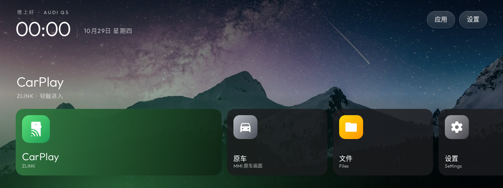
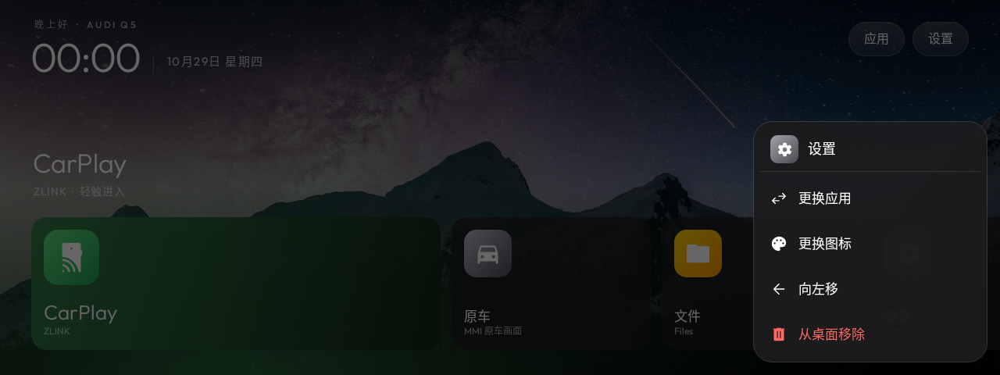
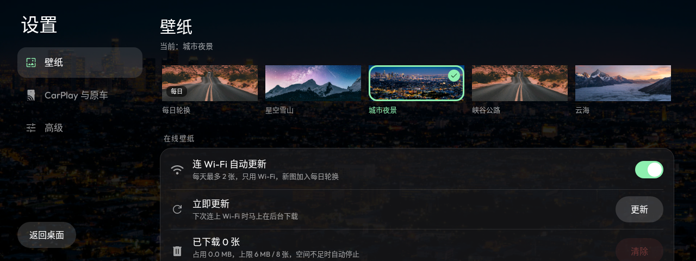

# audi-q5-launcher

2014 款奥迪 Q5（8R）安卓宽屏车机（WY 固件，Android 12）的简洁桌面和精简工具。

目标：
- 以 CarPlay 为主的简洁桌面，保留"原车"入口。
- 用 ADB 停用（不卸载）不需要的预装应用，可一键恢复。思路参考 [CleanYourTV](https://github.com/Gathin23/cleanyourtv)。

## 进度

1. 只读摸底：`tools/recon.sh`（见下文）
2. 桌面应用：`launcher/`（Kotlin，见下文"桌面应用"）
3. 精简：待摸底完成后再做

## 第一步：只读摸底

### 1. Mac 上准备 adb

```bash
brew install android-platform-tools
```

### 2. 连接车机（二选一）

**无线调试（推荐）**：车机和 Mac 连同一个 Wi-Fi（例如都连 iPhone 热点；
摸底时先断开无线 CarPlay，避免抢 Wi-Fi）。车机：开发者选项 → 无线调试 → 使用配对码配对。

```bash
adb pair <车机IP>:<配对端口>      # 输入车机上显示的配对码
adb connect <车机IP>:<调试端口>   # 无线调试页面上显示的端口
```

**USB**：用数据线连 Mac 和车机的 USB 口，车机上点"允许 USB 调试"。
（有些车机的 USB 口只能接 U 盘，不能调试，这种情况用无线。）

连好后 `adb devices` 应能看到设备。

### 3. 运行摸底

在本仓库目录打开 Claude Code，把 [PROMPT.md](PROMPT.md) 里的内容粘贴进去即可。
也可以手动执行：

```bash
tools/recon.sh                 # 已连接时
tools/recon.sh 192.168.x.x:端口  # 顺便连接
```

这个脚本只读，不会改动车机。输出在 `recon/`，含设备序列号，已被 git 忽略。

安全规则见 [CLAUDE.md](CLAUDE.md)。

## 第二步：桌面应用（launcher/）

仿 [CleanYourTV](https://github.com/Gathin23/cleanyourtv) 桌面风格：黑底、大时钟、磨砂胶囊按钮、
选中磁贴的名称和环境光。Kotlin + 传统 View，无第三方依赖，APK 约 1 MB（壁纸占大头）。



| 长按磁贴 | 设置 |
|---|---|
|  |  |
（1280×480 预览图，由截图测试生成。）

- **CarPlay 大磁贴**：自动找 ZLINK / DiPlay，找不到时长按指定。
- **原车磁贴**：自动按名称找"原车"应用；摸底查到真正的切换组件后，用 config.json 指定。
- **常用应用**：默认是"文件"和"设置"，点"+"添加，长按可换应用、换图标、移动、移除。
- **统一图标**：首页图标是重绘的一套（CarPlay、原车、文件、设置、导航、电话等），
  每个磁贴记"图标 + 目标应用"，以后换应用只改目标（app id），图标不变。
- **壁纸**：内置 6 张 Unsplash 壁纸，默认每天轮换，可指定或纯黑（来源见 [CREDITS.md](CREDITS.md)）。
- **在线壁纸自动更新**：连上 Wi-Fi 时每天最多下载 2 张新壁纸，加入轮换（见下文"在线壁纸"）。
- **检查更新**：每天检查一次 GitHub Release，有新版本时首页右上角出现绿色"新版本"胶囊；
  设置 →"版本更新"里看更新说明、下载并安装（见下文"版本与更新"）。
- 右上角"应用"是全部应用列表；"设置"是整页设置：左边分类（壁纸 / CarPlay 与原车 / 高级），右边内容，
  壁纸用缩略图选，开关是拨动开关，在线壁纸占用直接显示。
- 所有弹出的菜单、确认框、提示都是桌面自己画的（磨砂深色卡片），不用系统灰色弹窗；
  只有"系统设置""应用信息"会跳到安卓自带页面。
- 支持触摸，也支持旋钮/方向键选中（白色描边）。

### 安装

需要 JDK 17 和 Android SDK（装 Android Studio 最省事），然后：

```bash
launcher/build-and-install.sh            # 编译、安装、打开试用，不改默认桌面
launcher/build-and-install.sh --set-home # 试用没问题后，设为默认桌面（会确认并打印回滚命令）
```

不想在 Mac 上装 SDK：用 GitHub Actions 编译好的 APK（见下面"CI"），
然后 `launcher/build-and-install.sh --apk 下载的.apk`。

### CI（GitHub Actions）

每次推送 `launcher/` 或 `ci/` 都会跑，在仓库 Actions 页面的运行记录里下载附件：

| 附件 | 内容 |
|---|---|
| `q5home-apk` | 桌面 APK，可直接装到车机 |
| `screenshots` | 截图测试：1280×480、1920×720、1024×600、纯黑壁纸、应用列表 |
| `test-reports` | 单元测试和 lint 报告 |
| `emulator-demo` | 安卓 12 模拟器（1920×720）上的录屏和每一步截图（见下） |

`emulator-demo` 里：
- `demo.mp4`：演示录屏。视频下方是中文步骤字幕栏；点击处有白色圆环，长按是橙色圆环；按键（HOME、返回、方向键）看字幕。
- `demo-raw.mp4` + `captions.srt` + `taps.json`：原始录屏、字幕和点击记录。
- `NN-*.png`：每一步截图，红圈标出这一步点击的位置。

模拟器里用 `launcher/fakeapps` 编出的假 ZLINK 和假原车应用（只在 CI 用，不要装到车机）。
演示步骤见 `ci/demo.py`。本地跑测试：`cd launcher && ./gradlew :app:testDebugUnitTest`。

### 用 config.json 配置

```bash
adb push config.json /sdcard/Android/data/com.x0finch.q5home/files/config.json
adb pull /sdcard/Android/data/com.x0finch.q5home/files/current.json   # 查看当前生效的配置
```

字段见 [launcher/config.example.json](launcher/config.example.json)。

- 目标（target）的写法：`包名`、`包名/类名`、`action:动作`、`broadcast:动作@包名`。
- `dock` 每项可以是 `{"icon": "files", "target": "包名"}`，也可以只写目标（图标自动猜）。
  图标可选：`carplay` `oem` `files` `settings` `nav` `phone` `radio` `video` `music` `bluetooth` `browser` `photos` `apps`。
- `wallpaper`：`daily`（每日轮换）、`none`（纯黑），或 `stars` `city` `road` `clouds` `lake` `forest`。

### 在线壁纸

连上 **Wi-Fi（不计流量的网络）** 时，后台每天最多下载 2 张新壁纸，加入每日轮换。

- **来源**：默认读仓库里的精选清单 [wallpapers/feed.json](wallpapers/feed.json)，往清单末尾加 Unsplash 的 photo id，
  车机下次连 Wi-Fi 就会下载，不用重装 APK。（读的是仓库默认分支，合并后生效。）
  想要每天都是全新的图：去 [unsplash.com/developers](https://unsplash.com/developers) 免费申请一个 Access Key，
  写进 config.json 的 `unsplashKey`，会按 `wallpaperQuery` 随机取图，右下角显示摄影师署名。
- **存储上限**：最多存 8 张、合计不超过 6 MB，超出删最旧的；每张由 Unsplash 服务器按屏幕裁好再下载（约 300–400 KB），
  单张超过 1.5 MB 放弃；车机剩余空间低于 300 MB 时不下载，并只留最新 2 张。
- **设置里**：在线壁纸开/关、立即更新、清除在线壁纸（显示当前占用）。内置壁纸不受影响。

## 版本与更新

- **版本号**：`1.0.<提交数>`，每次提交自动加一（内部 versionCode = 提交数 × 10，回退发布用个位数）。
- **发布**：每次推送到 `main`，CI 编译、测试、模拟器演示都通过后，自动发布 GitHub Release `v1.0.<提交数>`，附带 APK，
  更新说明取自提交信息。
- **车机上更新**：设置 →"版本更新"→"下载并安装"。下载后会校验 sha256、包名和版本号，然后弹出安卓系统的安装确认。
  第一次需要允许 Q5 Home"安装未知应用"（页面会引导去系统设置）；车机上找不到这个开关时，用电脑执行：
  ```bash
  adb shell appops set com.x0finch.q5home REQUEST_INSTALL_PACKAGES allow
  ```
- **签名**：所有构建（本地、CI、Release）都用 `launcher/signing/q5home.keystore` 签名，所以新版本能直接覆盖旧版本、设置不丢。
  按你的选择，这个密钥放在公开仓库里：别人也能用它签出"看起来是 Q5 Home"的安装包。
  车机只会从你自己仓库的 Release 下载更新，所以风险很低；但不要从别处装来历不明的 Q5 Home 安装包。
  以后想换成更安全的做法，可以把密钥移到 GitHub Secrets（换密钥需要卸载重装一次）。

## 更新后出问题怎么办（崩溃回退）

三层保护：

1. **防**：模拟器演示通过（含"没有意外崩溃"）才会发布，崩溃的版本到不了车机。
2. **护**：同一版本 10 分钟内崩溃 3 次，桌面自动进入**安全模式**：一个极简页面（不加载壁纸、磁贴和在线功能），
   有"打开 CarPlay""打开原车""回到原厂桌面""安装修复 / 回退版本""再试一次正常启动"几个大按钮，不会卡在反复崩溃里。
   装上新版本（修复或回退）后自动恢复正常。
3. **退**：安卓不允许直接装回版本号更低的旧包，所以用这些办法：
   - **回退发布（推荐，不用电脑）**：手机打开 GitHub 仓库 → Actions → **rollback** → Run workflow，
     填要回退到的版本号（例如 `1.0.12`）。几分钟后会发布 `1.0.<当前提交数>.1`，内容就是那个旧版本；
     车机在安全模式或"版本更新"里点安装即可。
   - **修复发布**：让 Claude Code 撤销有问题的改动（`git revert`）推到 main，自动发布新版本。
   - **adb 降级**（需要电脑，且车机允许降级，`getprop ro.debuggable` 为 1）：`adb install -r -d 旧版本.apk`。

另外，安卓自己也有一层保护：默认桌面反复崩溃时，系统会取消它的默认身份，按 HOME 时让你重新选桌面——
这时也可以直接选原厂桌面。

设置数据始终保持向后兼容，回退后旧版本也能读懂新版本存下的设置。
